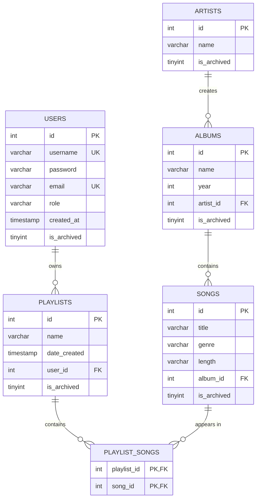

# 🎵 Recording Studio Console App (`RecordingStudioCli`)

A Java console application for managing a recording studio's catalog of **artists, albums, songs, users, and playlists**. Built with **JDBC and MySQL** using a clean **3-tier architecture** (`view`, `service`, `repository`) with Role-Based Access Control (RBAC), soft-delete archiving, and BCrypt authentication for the **Programming (Java) NC III** course.

---

## Table of Contents

- [Features](#features)
- [Tech Stack](#tech-stack)
- [Architecture](#architecture)
- [Project Structure](#project-structure)
- [Database Design](#database-design)
- [Role Permissions & Use Cases](#role-permissions--use-cases)
- [Getting Started](#getting-started)
- [Running the App](#running-the-app)
- [Sample Usage](#sample-usage)
- [Design Decisions](#design-decisions)
- [Troubleshooting](#troubleshooting)
- [Author](#author)
- [Acknowledgements](#acknowledgements)

---

## Features

- **Full CRUD, Search, and Soft Delete (Archive / Restore)** across all five core modules: **Artists, Albums, Songs, Users, and Playlists**
- **Authentication & Security:**
  - User registration and login powered by **jBCrypt** password hashing (`org.mindrot:jbcrypt`)
  - Automatic default `ADMIN` account seeding on startup if no active admin exists in the database
  - SQL-injection protection using parameterized `PreparedStatement` queries and `try-with-resources`
- **Role-Based Access Control (RBAC):**
  - **`ADMIN`:** Full CRUD, search, archive, restore, and permanent delete across Songs, Artists, Albums, Users, and all Playlists
  - **`USER`:** Browse and search active Songs, Artists, and Albums; create and manage **only their own** playlists (enforced by `user_id` ownership checks)
- **Many-to-Many Playlist Songs (`playlist_songs`):**
  - View songs inside a playlist, add songs from the catalog, and remove songs from a playlist
  - Duplicate song entries per playlist are prevented by a composite primary key `(playlist_id, song_id)`
- **Guard-Clause Input Validation & Safe Console UX:**
  - Service-layer guard clauses validate required text fields, positive IDs, release years (`1900`–`2100`), email format, and password length (`>= 6` characters) before hitting the database
  - Safe integer input loop (`promptForInt`) prevents crashes on non-numeric console input
  - Archived records are displayed first before prompting for an ID to restore, and active tables refresh automatically after changes

---

## Tech Stack

| Area | Technology                                       |
| :--- |:-------------------------------------------------|
| Language | Java 17                                          |
| Database | MySQL 8.x (`recording_studio_db`)                |
| Data Access | JDBC (`PreparedStatement`, `try-with-resources`) |
| Build Tool | Maven                                            |
| Password Hashing | jBCrypt (`org.mindrot:jbcrypt:0.4`)              |
| IDE | IntelliJ IDEA                                    |

---

## Architecture

The application follows a **3-tier architecture** with bottom-up dependency wiring (`DbConnection -> Repository -> Service -> View -> App`) and strict top-down runtime calls:

```text
┌──────────────────────┐
│    View Tier (UI)    │   Console menus, Scanner input, formatted tables
└──────────┬───────────┘
           │ calls
┌──────────▼───────────┐
│     Service Tier     │   Guard-clause validation, RBAC scoping, BCrypt
└──────────┬───────────┘
           │ calls
┌──────────▼───────────┐
│   Repository Tier    │   JDBC PreparedStatements, ResultSet mapping
└──────────┬───────────┘
           │
        ┌──▼──┐
        │MySQL│
        └─────┘
```

| Package | Responsibility | Must **Not** |
| :--- | :--- | :--- |
| **`view`** | Display menus and tables, collect `Scanner` input, handle menu loops | Contain raw SQL queries or business validation rules |
| **`service`** | Enforce guard clauses, ownership/role checks, and `BCrypt` hashing/verification | Execute SQL directly or read console input |
| **`repository`** | Execute parameterized SQL via JDBC and map `ResultSet` rows to model objects | Contain UI prompts or business validation |
| **`model` / `config`** | Plain Java domain entities (`Artist`, `Album`, `Song`, `Playlist`, `User`) and `DbConnection` | Depend on upper tiers |

**Key principles applied:** Separation of Concerns, Programming to Interfaces, Constructor Dependency Injection, and Fail-Fast Guard Clauses.

---

## Project Structure

```text
RecordingStudioCli
├── pom.xml
└── src/main/java/com/joysistvi/recordingapp
    ├── App.java                       # Entry point: bottom-up wiring, auth flow, & RBAC dashboards
    ├── config
    │   └── DbConnection.java          # MySQL JDBC connection provider
    ├── model
    │   ├── Album.java
    │   ├── Artist.java
    │   ├── Playlist.java
    │   ├── Song.java
    │   └── User.java
    ├── repository
    │   ├── AlbumRepository.java
    │   ├── AlbumRepositoryImpl.java
    │   ├── ArtistRepository.java
    │   ├── ArtistRepositoryImpl.java
    │   ├── PlaylistRepository.java
    │   ├── PlaylistRepositoryImpl.java
    │   ├── SongRepository.java
    │   ├── SongRepositoryImpl.java
    │   ├── UserRepository.java
    │   └── UserRepositoryImpl.java
    ├── service
    │   ├── AlbumService.java
    │   ├── AlbumServiceImpl.java
    │   ├── ArtistService.java
    │   ├── ArtistServiceImpl.java
    │   ├── PlaylistService.java
    │   ├── PlaylistServiceImpl.java
    │   ├── SongService.java
    │   ├── SongServiceImpl.java
    │   ├── UserService.java
    │   └── UserServiceImpl.java
    └── view
        ├── AlbumView.java
        ├── ArtistView.java
        ├── PlaylistView.java
        ├── SongView.java
        └── UserView.java
```

---

## Database Design

**Database name:** `recording_studio_db`

### Entity Relationships

- An **Artist** has many **Albums** (1:N)
- An **Album** contains many **Songs** (1:N)
- A **User** owns many **Playlists** (1:N)
- A **Playlist** contains many **Songs**, and a **Song** can belong to many **Playlists** (M:N via `playlist_songs`)
- All foreign keys enforce **`ON DELETE RESTRICT`** and **`ON UPDATE CASCADE`** to protect referential integrity



### Tables

| Table | Columns & Constraints |
| :--- | :--- |
| `artists` | `id` (PK, AI), `name` (NOT NULL), `is_archived` (`TINYINT(1)` DEFAULT `0`) |
| `albums` | `id` (PK, AI), `name` (NOT NULL), `year` (INT), `artist_id` (FK -> `artists.id`), `is_archived` (`TINYINT(1)` DEFAULT `0`) |
| `songs` | `id` (PK, AI), `title` (NOT NULL), `genre`, `length` (e.g., `3:45`), `album_id` (FK -> `albums.id`), `is_archived` (`TINYINT(1)` DEFAULT `0`) |
| `users` | `id` (PK, AI), `username` (UNIQUE), `password` (`VARCHAR(255)` BCrypt hash), `email` (UNIQUE), `role` (`USER` / `ADMIN`, DEFAULT `'USER'`), `created_at` (TIMESTAMP), `is_archived` (`TINYINT(1)` DEFAULT `0`) |
| `playlists` | `id` (PK, AI), `name` (NOT NULL), `date_created` (TIMESTAMP), `user_id` (FK -> `users.id`), `is_archived` (`TINYINT(1)` DEFAULT `0`) |
| `playlist_songs` | `playlist_id` (PK, FK -> `playlists.id`), `song_id` (PK, FK -> `songs.id`) — composite PK prevents duplicate songs in the same playlist |

---

## Role Permissions & Use Cases

| Module | `ADMIN` | `USER` |
| :--- | :--- | :--- |
| **Authentication** | Login, Register, Logout | Login, Register, Logout |
| **Songs** | View Active, Create, Update, Search, Archive, Restore, Permanent Delete | View Active, Search |
| **Artists** | View Active, Create, Update, Search, Archive, Restore, Permanent Delete | View Active, Search |
| **Albums** | View Active, Create, Update, Search, Archive, Restore, Permanent Delete | View Active, Search |
| **Playlists** | Manage all playlists and their songs (CRUD, Archive, Restore, Add/Remove Songs) | Manage **own playlists only** (CRUD, Archive, Restore, View/Add/Remove Songs) |
| **Users** | View Active, Create, Update, Search, Archive, Restore, Permanent Delete | Access Denied |

> Self-registration always assigns the role `'USER'`. On startup, if no active `ADMIN` account exists, the app automatically seeds a default admin (`admin` / `admin123`) with a valid BCrypt hash.

---

## Getting Started

### Prerequisites

- **JDK 17** or newer
- **MySQL 8.x** (e.g., via XAMPP / phpMyAdmin or MySQL Server)
- **Maven 3.8+** (or bundled Maven in IntelliJ IDEA)
- Git

### 1. Clone the Repository

```bash
git clone https://github.com/<your-github-username>/<your-repository-name>.git
cd <your-repository-name>
```

### 2. Set Up the Database

1. Start your MySQL server and create a database named `recording_studio_db`.
2. Create the six tables (`artists`, `albums`, `songs`, `users`, `playlists`, and `playlist_songs`) with their foreign keys (`ON DELETE RESTRICT`, `ON UPDATE CASCADE`) and `is_archived TINYINT(1) NOT NULL DEFAULT 0` columns on the five main tables.

### 3. Configure Database Credentials

Open `src/main/java/com/joysistvi/recordingapp/config/DbConnection.java` and verify your local MySQL credentials:

```java
private static final String URL = "jdbc:mysql://localhost:3306/recording_studio_db";
private static final String USERNAME = "root";
private static final String PASSWORD = "";
```

> Never commit production or personal database passwords to a public GitHub repository.

### 4. Promote an Existing User to Admin (Optional)

If you want to promote an additional registered user to `ADMIN`, run:

```sql
USE recording_studio_db;
UPDATE users SET role = 'ADMIN' WHERE username = 'your_username';
```

---

## Running the App

### Option A: From IntelliJ IDEA

1. Open the project in IntelliJ IDEA and reload Maven dependencies (`mysql-connector-j` and `org.mindrot:jbcrypt`).
2. Run `src/main/java/com/joysistvi/recordingapp/App.java`.

### Option B: Build a Runnable JAR with Maven

If configured with the Maven Shade Plugin in `pom.xml`:

```bash
mvn clean package
java -jar target/RecordingStudioCli-1.0-SNAPSHOT.jar
```

### Option C: Build a Runnable JAR with IntelliJ Artifacts

1. Go to **File → Project Structure → Artifacts → + → JAR → From modules with dependencies**.
2. Set **Main Class** to `com.joysistvi.recordingapp.App`, click **OK**, then **Apply**.
3. Go to **Build → Build Artifacts → Build**.
4. Run the generated JAR from your project root:
   ```powershell
   cd out\artifacts\RecordingStudioCli_jar
   java -jar RecordingStudioCli.jar
   ```

---

## Sample Usage

```text
=== RECORDING STUDIO AUTH ===
1. Login
2. Register
0. Exit
Choice: 1

Enter username: roblox
Enter password: ******
Login successful! Welcome, roblox (USER).

=== USER DASHBOARD (roblox) ===
1. Browse Songs
2. Browse Artists
3. Browse Albums
4. My Playlists
0. Logout
Choice: 4

=== MY PLAYLISTS ===
1. View All Active
2. Create
3. Update
4. Search
5. Archive (Soft Delete)
6. Restore Archived
7. Delete (Permanent)
8. View Songs in Playlist
9. Add Song to Playlist
10. Remove Song from Playlist
0. Back
Choose an option: 2

Enter playlist name: Pedropenduko
Playlist created successfully!

----- My Active Playlists -----
ID   Playlist Name            Owner              Date Created
4    Pedropenduko             roblox             2026-11-25 12:15:00.0
```

---

## Design Decisions

- **Soft Delete (`is_archived`) across all core tables:** Preserves historical records and prevents accidental data loss while allowing admins (and playlist owners) to restore archived items.
- **`ON DELETE RESTRICT` + `ON UPDATE CASCADE`:** Prevents orphaned child rows (e.g., deleting an artist who still has albums, or deleting a user who still owns playlists) while safely propagating key updates.
- **Role-based ownership scoping:** Regular `USER` accounts are automatically restricted at the SQL level (`WHERE ... AND user_id = ?`) so they can only view and modify their own playlists.
- **BCrypt password hashing in the Service layer:** Plain-text passwords never reach the repository or database; `BCrypt.hashpw` and `BCrypt.checkpw` live exclusively inside `UserServiceImpl`.
- **Startup Admin Seeder:** Automatically creates a valid BCrypt-hashed `ADMIN` account when none exists, avoiding invalid plain-text hashes typed manually into phpMyAdmin.
- **Interface-driven Service & Repository layers:** Decouples business logic and views from JDBC implementations for cleaner maintainability and testing.

---

## Troubleshooting

| Problem | Cause & Fix |
| :--- | :--- |
| `Login failed: Stored password hash format is invalid.` | The user's password in MySQL was inserted as plain text or a dummy string instead of a BCrypt hash. Register the account through the app (or let the startup admin seeder create it) so `BCrypt.hashpw` generates a valid `$2a$...` hash. |
| `Cannot delete or update a parent row: a foreign key constraint fails` | Expected behavior from `ON DELETE RESTRICT`. Archive the record instead, or remove dependent child records (e.g., songs in `playlist_songs` or albums linked to an artist) before permanently deleting. |
| `Unknown database 'recording_studio_db'` | Create the `recording_studio_db` schema in MySQL / phpMyAdmin before running `App.java`. |
| `Unknown column 'is_archived' in 'where clause'` | Add `is_archived TINYINT(1) NOT NULL DEFAULT 0` to `artists`, `albums`, `songs`, `users`, and `playlists`. |
| `Cannot resolve symbol 'mindrot'` / `'BCrypt'` | Add `org.mindrot:jbcrypt:0.4` to `pom.xml` and click **Reload All Maven Projects** in IntelliJ. |
| `Access denied for user 'root'` | Update `USERNAME` and `PASSWORD` in `DbConnection.java` to match your local MySQL server. |

---

## Author

**<Your Name>**  
Joseph Daniel Cristobal, Programming (Java) NC III — Joysis Tech Voc Inc.  
GitHub: [@Paqluy2](https://github.com/Paqluy2)

---

## Acknowledgements

- Course Instructor: Jareth Ronquillo, Joysis Tech Voc Inc.